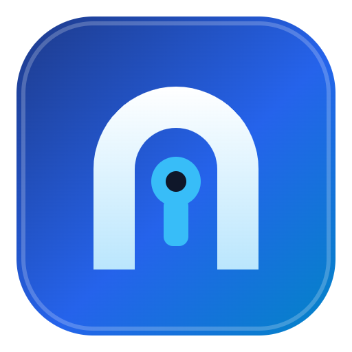

<p align="center">
  
</p>

<h1 align="center">TPM-PROJETO</h1>

<p align="center">
  Compartilhe um site do <strong>Laragon</strong> (ou servidor local) com qualquer pessoa pela internet através de um link temporário protegido por código numérico — sem configurar roteador, sem conta e sem linha de comando.
</p>

<p align="center">
  <a href="https://fabiano-couto.github.io/TPM-PROJETO/"><strong>Página oficial de download</strong></a>
  &nbsp;·&nbsp;
  <a href="https://github.com/Fabiano-Couto/TPM-PROJETO/releases/latest"><strong>Baixar instalador (v0.3.0)</strong></a>
  &nbsp;·&nbsp;
  <a href="#verificação-de-integridade-sha-256"><strong>Conferir SHA-256</strong></a>
</p>

---

## Como funciona na prática

1. **Escolha o site local** — lista automaticamente seus projetos do Laragon (Apache ou Nginx), sem expor a página padrão, ou aceite qualquer servidor local em execução (ex.: `localhost:3000`).
2. **Defina duração e compartilhe** — em segundos você recebe um link público (`https://…trycloudflare.com`), um código numérico de 6 dígitos e o botão **Copiar mensagem** pronto para enviar ao cliente ou colega.
3. **Acesso protegido até o horário** — sem o código, nada chega ao seu computador. Ao terminar o prazo (ou ao clicar em **Parar**), quem estava navegando cai na hora e o túnel encerra sozinho.

## Proteções incluídas

- **Código aleatório de 6 dígitos por link** — gerado com aleatoriedade criptográfica; vários compartilhamentos simultâneos nunca compartilham o mesmo código.
- **Bloqueio automático de ferramentas sensíveis** — impede acesso externo a `/phpmyadmin`, `/adminer`, `/redis`, `/memcached`, `.env`, rotas de debug (Telescope, Horizon, Pulse, Clockwork) e arquivos ocultos pelo link.
- **Proteção contra força bruta** — 5 códigos errados bloqueiam o visitante por 15 minutos (com opção de liberar ou trocar o código pelo aviso do Windows) e um teto de 30 erros encerra novas tentativas até trocar o código.
- **Zero alteração no seu Laragon ou projeto** — o aplicativo apenas lê os virtual hosts; reescreve referências locais na resposta pelo túnel sem deixar service worker nem cache público no navegador do visitante.
- **Bandeja do sistema e notificações** — continua perto do relógio com indicador verde quando há link ativo, notifica 5 minutos antes do fim com `+30 min` e encerra todos os túneis limpo ao sair.
- **Instalação por usuário e desinstalação limpa** — não pede senha de administrador, não exige regra de entrada no firewall e remove arquivos, atalhos e chaves de notificação ao desinstalar.

## Download e instalação (Windows 10 / 11 · 64 bits)

Baixe o instalador da versão atual pela página oficial ou em [**Releases**](https://github.com/Fabiano-Couto/TPM-PROJETO/releases/latest):

| Versão | Arquivo | Tamanho |
|---|---|---|
| **v0.3.0** | `tpm-projeto-amd64-installer.exe` | 26.563.501 bytes |

### Novidades na v0.3.0

- **Indicador ao vivo no cartão:** mostra se o link está em **Aguardando acesso**, **Em uso agora** ou **Inativo há X min** (apenas em memória, sem gravar histórico).
- **Janela fixa ampla com Maximizar:** abre em tamanho fixo compatível (`1040×740`, ajustado à tela) evitando redimensionamento acidental pelas bordas e mantendo o botão nativo **Maximizar**.
- **Modal amplo na bandeja:** confirmações de **Parar tudo** e **Sair** (quando há links no ar) agora abrem em modal retangular amplo dentro da janela principal.
- **Correção da chave Pix:** QR Code e cópia atualizados no botão **Me pague um café** para o CNPJ `67.712.619/0001-08` (recebedor `TPM PROJETO`, valor livre).

### Novidades na v0.2.0

- Botão **Me pague um café** na barra superior do aplicativo: abre um QR Code Pix (chave CNPJ `67.712.619/0001-08`, sem valor fixo) e opção **Pix Copia e Cola**.
- Lembrete discreto ao compartilhar um site (nunca impede nem atrasa o compartilhamento), com opção **Já apoiei / não mostrar mais** salva localmente.

### Sobre o aviso do Windows (SmartScreen)

Por ser um utilitário independente ainda **sem certificado pago de assinatura digital**, o Windows pode exibir a tela azul **"O Windows protegeu o computador"** ao executar o instalador baixado da internet.

Para confirmar a autenticidade antes de executar:

1. Confira o código **SHA-256** do arquivo baixado (comando abaixo).
2. Se bater exatamente, clique em **Mais informações** → **Executar assim mesmo**.
3. O instalador instala apenas na sua conta de usuário (`%LOCALAPPDATA%\Programs\TPM-PROJETO`) sem pedir permissão de administrador.

## Verificação de integridade (SHA-256)

No **PowerShell**, na pasta onde salvou o arquivo:

```powershell
Get-FileHash .\tpm-projeto-amd64-installer.exe -Algorithm SHA256
```

Confira se o valor gerado é idêntico a:

```text
6F231F5EC94BD197BA28C11AAE12595824102C9C3585CFDA6A3DE9253108E54B
```

## Requisitos

- Windows 10 ou Windows 11 (64 bits).
- Conexão com a internet para criar links públicos via Cloudflare Quick Tunnel.
- Laragon (detectado automaticamente) ou qualquer servidor web rodando em `localhost:porta`.

## Componentes de terceiros e licença

Este pacote inclui o binário oficial **`cloudflared` 2026.10.7** (Cloudflare, Inc.), verificado em disco por SHA-256, distribuído sob a licença **Apache-2.0** ([Apache License, Version 2.0](https://www.apache.org/licenses/LICENSE-2.0)). Veja também [THIRD-PARTY-NOTICES.txt](THIRD-PARTY-NOTICES.txt) e o painel **Sobre** dentro do aplicativo.
